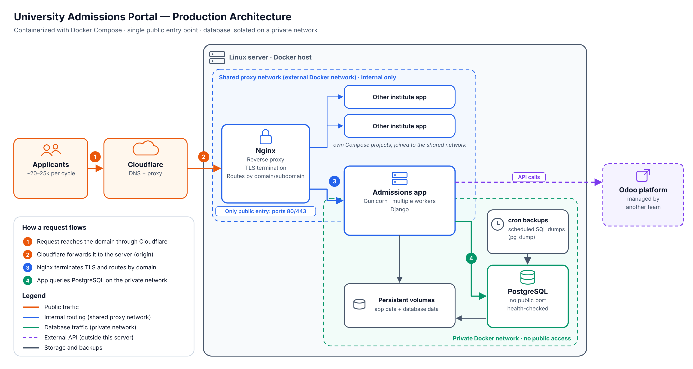

# Case Study: GIKI Admissions Portal — Containerized Production Deployment

**Role:** Designed and implemented the full production deployment
**Stack:** Docker · Docker Compose · Nginx · Gunicorn · Django · PostgreSQL · Cloudflare · Bash/cron · TLS
**Scale:** Graduate and undergraduate admissions — roughly 20,000–25,000 applicants

---

## Context

GIK Institute's admissions portal handles graduate and undergraduate applications. Every admission cycle brings heavy, bursty traffic as applicants submit forms close to deadlines, and outages land directly on students and the admissions office.

## The Problem

The portal originally ran without containers or a reverse proxy, on a **single Gunicorn worker**. Under admission-season load it:

- responded slowly and **crashed under peak traffic**
- made updates slow and risky, with long delays during releases
- broke when environment variables were missed or a service was not running, often found only after users reported errors

The result was pressure on the team from administration and a poor experience for applicants.

## How It Was Diagnosed

1. **Symptom:** applicants were getting **502 and 504 errors** from Cloudflare, which sits in front of the main domain. These mean the origin server failed to respond in time (504) or returned no valid response (502). The problem was at the origin, not in Cloudflare.
2. **Server resources first:** checked CPU and memory on the host with Linux command-line tools. The server had many vCPUs, but **only a few were in use** during the slowdowns. The hardware was not the bottleneck. The application was failing to use the capacity it had.
3. **Application logs and configuration:** this pointed to the application server. The logs and the Gunicorn configuration showed it was running a **single worker**.
4. **Conclusion:** a single sync worker serves one request at a time. Under admission-season load, requests queued behind it until the origin timed out and Cloudflare returned 502/504 errors, while most CPU cores sat idle.

## What I Built

### 1. Containerized architecture with network isolation

- **Nginx** is the only public entry point. It proxies requests to Gunicorn.
- **Django + Gunicorn** sits behind Nginx. It reaches the database over a private network.
- **PostgreSQL** is on a private Docker network only, never exposed publicly.
- **Docker Compose** defines and manages all services.

### 2. Performance and stability tuning

- Scaled Gunicorn from a single worker to multiple workers, tuned for the server's resources.
- Tuned PostgreSQL connection limits and timeouts for concurrent load.
- Applied standard production settings to Nginx, Gunicorn and PostgreSQL for high request volumes.

### 3. Reliable startup and configuration

- **Health-gated startup:** the application waits until PostgreSQL reports healthy before connecting and running initial and updated migrations. This removed failures caused by services starting out of order.
- **Centralized environment configuration:** database credentials, API keys, and endpoints to other systems (including the Odoo integration) are defined per service, instead of being set by hand and forgotten.

### 4. Data protection

- Persistent Docker volumes for application and database data.
- Scheduled database backups using cron and SQL dumps.

### 5. Centralized HTTPS for the whole server

The server hosted several other applications that also needed HTTPS. I made Nginx the **single entry point for every application on the server**:

- routing by domain and subdomain to each application
- a shared **external Docker network**, so Nginx can reach applications running in separate Compose projects
- SSL certificates and configuration **managed in one place**, so one renewal now covers every application

## A Second Problem: Idle Database Connections

After the redeployment, a new issue appeared: database connections were left **idle while still holding resources**, which steadily used up the connection capacity.

**Fix:** connection pooling and idle-session timeouts, so stale connections are flushed and resources are released.

## Results

- The portal handled admission-season traffic for roughly 20,000–25,000 applicants without the earlier crashes.
- Updates and restarts became repeatable through Docker Compose instead of manual steps.
- Missed-configuration and out-of-order startup failures were eliminated.
- The database is isolated on a private Docker network with no public port.
- Every application on the server got HTTPS, with certificates managed in one place.

## Lessons Learned

- A single worker with no reverse proxy is a capacity limit you only discover under real load. Size for peak traffic, not average.
- Fixing throughput can expose the next bottleneck. Here it was connection handling in the database.
- Centralizing TLS and routing reduced day-to-day operational work for the whole server, not just this one app.
